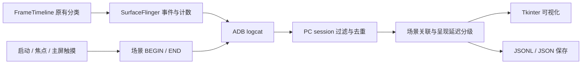

# Android16-jank · MUST Scene-Aware Jank Monitor

**Android 16 / LineageOS 23.2 场景感知 Jank 监测项目**

A system-wide FrameTimeline-based Jank monitor with scene correlation and a Python/Tkinter desktop dashboard. Android determines Deadline Jank; the PC correlates interaction scenes, grades presentation lateness, visualizes type distributions, and saves session evidence.

## 当前进度（2026-10-18）

| 部分 | 当前状态 |
|---|---|
| Android 监测器 | 已实现 must_jank 服务、FrameTimeline 分类提取、持续会话与累计统计 |
| 场景 | 应用启动、应用切换、触摸拖动、惯性滑动请求；后两项包含启发式推断 |
| PC 界面 | Python/Tkinter 实时监测页与独立整页类型统计页 |
| 呈现延迟分级 | low / medium / high / ungraded；各等级类型独立降序排名 |
| 记录 | JSONL 事件、场景、设备快照、会话元数据与等级汇总 |
| 真机产物 | OnePlus 11 / salami，2026-10-15 UNOFFICIAL userdebug 构建 |
| PC 源码版本 | 2026-10-18；本发布提供源码启动包，不提供更新后的 EXE |
| 根因分析 | 已提供类型、时间、归属和场景线索；调度/GC/锁/GPU 自动根因取证尚未实现 |

本项目为实验用途的自定义系统和工具。镜像是非官方 userdebug 构建；已有单元测试不等于所有 App 或长时间运行稳定性已验证。

## 下载

刷机文件及 PC 源码启动包放在 [GitHub Releases](https://github.com/Kimberley-Inti/Android16-jank/releases)，不存入普通 Git 历史。

本次版本：[`must-jank-2026.10.18`](https://github.com/Kimberley-Inti/Android16-jank/releases/tag/must-jank-2026.10.18)。

- `lineage-23.2-20261015-UNOFFICIAL-salami.zip.part.001/.002`：原始系统 ZIP 的两段；须合并并校验后才可 sideload。
- `boot.img`、`dtbo.img`、`init_boot.img`、`vbmeta.img`、`vendor_boot.img`、`recovery.img`：同一构建的配套镜像。
- `MUST_Jank_Monitor_PC_20261018.zip`：Windows/Linux PC Python 界面及启动脚本。
- `merge_rom.py`、`merge-rom.cmd`、`release-assets.json`、`SHA256SUMS.txt`：合并与校验工具及文件清单。

刷机包原始大小为 2,175,603,032 字节，超过 GitHub Release 单文件 2 GiB 限制，因此分段上传。合并不重新压缩或修改 ZIP 内容。

**安装与合并说明：[docs/RELEASE.md](docs/RELEASE.md)**。仅适用于 salami，不能给 x86 模拟器或其他机型刷入。

## 快速开始：PC 监测器

### Windows

安装带 Tcl/Tk 的 Python 3.10+ 和 Android Platform-Tools，使 adb.exe 在 PATH 中可用。下载 PC ZIP 或克隆本仓库：

```powershell
git clone https://github.com/Kimberley-Inti/Android16-jank.git
cd Android16-jank
cd .\tools\must-jank-monitor
py -3 main.py
```

也可在工具目录双击 `启动监测器.bat`，它启动当前 Python 源码。

### Linux

```bash
sudo apt install python3-tk adb
git clone https://github.com/Kimberley-Inti/Android16-jank.git
cd Android16-jank/tools/must-jank-monitor
python3 main.py
```

界面无需 Streamlit、Pandas、Plotly。手机必须运行带本项目服务的匹配 ROM，启用 USB 调试并授权电脑。

### 一次采集

1. 选择 ADB 状态为 device 的设备，点击 START。
2. 确认出现 session ID 后在手机使用应用；同一 session 可连续切换多个 App。
3. 监测页查看 Deadline 事件、图层归属和场景；统计页查看各等级类型排名。
4. 点击 STOP，等待最终记录保存；打开会话文件夹查看 `sessions/` 下数据。
5. 连接中断后可接回仍在运行的设备会话，但不会补齐断连前/期间的全部历史事件。

命令行控制：

```bash
adb -s <serial> shell cmd must_jank status
adb -s <serial> shell cmd must_jank start
adb -s <serial> shell cmd must_jank stats
adb -s <serial> shell cmd must_jank stop
```

## 工作原理



### 统计口径

- **Deadline Jank**：设备 `jank_type` 包含 AppDeadlineMissed、SF CPU Deadline Missed 或 SF GPU Deadline Missed，即掩码 `0xE`。PC 使用设备明确输出的 `deadline_jank`。
- **辅助标签**：单独 BufferStuffing、PredictionError 等不进入 Deadline 主计数。`AppDeadlineMissed + BufferStuffing` 组合仍计为一条 Deadline 事件。
- **单位**：SurfaceFrame；一个屏幕刷新可涉及多个图层事件，不等于一次主观卡顿或 episode。
- **顶部统计**：设备全 session、全图层的累计值，Jank 比例为 janky_frames / valid_frames。
- **等级/类型分布**：本地接收窗口内的事件；接回会话时不能与设备全历史数量混为一谈。
- **类型是位掩码**：一条事件可命中多个标签，拆分标签占比之和可超过 100%。

### 延迟等级

`ratio = (actual_present_ns - expected_present_ns) / (1e9 / refresh_rate)`。

| 等级 | 呈现延迟周期数 |
|---|---|
| low | 0 < ratio < 1 |
| medium | 1 ≤ ratio < 3 |
| high | ratio ≥ 3 |
| ungraded | Deadline 已确认，但有效呈现延迟或刷新率不足 |

这是对设备已确认 Deadline 事件的展示分级，保留 Android 原生 severity，不改变 FrameTimeline 判定，也不是已验证的主观严重程度标准。

### 场景与根因边界

触摸移动不代表页面真的滚动，惯性场景是速度推断的固定时间窗。时间重叠只能提供交互上下文，不能证明某 App 或手势造成了该帧卡顿。UNKNOWN 的图层推断显示标签不应当作真实交互分类。

当前不输出全量正常帧，也未实现 episode 聚合、多 run 自动报表、统一质量判级或 Perfetto 根因自动诊断。

## 目录结构

```text
baseline/                         早期基线记录，保留原内容
patches/choreographer-jank-v1.patch 早期实验探针，当前方案不依赖它
patches/must-monitor/              当前方案的三个 Android 仓库补丁
source/current-baseline-manifest.xml 当前方案应用补丁前的固定版本
source/baseline-revisions.json     补丁基线与本地备份提交对应关系
source/modified-files/            被修改 Android 文件的完整快照
source/firmware-build-info.json    已有手机产物的构建来源
scripts/apply_must_patches.py      基线检查与补丁应用
scripts/merge_rom.py               Release 分段合并与校验
scripts/merge-rom.cmd              Windows 合并入口
tools/must-jank-monitor/           当前 PC 源码、启动脚本及详细技术文档
docs/                             构建、发布和故障修复说明
```

## 构建与技术文档

- [当前实现详细技术文档](tools/must-jank-monitor/docs/当前实现技术文档.md)
- [PC 使用说明](tools/must-jank-monitor/README_Windows.md)
- [分级与类型频次](tools/must-jank-monitor/docs/分级与类型频次说明.md)
- [源码基线、应用补丁与构建](docs/BUILD.md)
- [刷机文件与 Release 使用](docs/RELEASE.md)
- [SurfaceFlinger 显示切换死锁修复记录](docs/surfaceflinger-freeze-fix.md)

早期 `baseline/` 的 frameworks/base 版本与当前方案不同。复现当前实现请使用 `source/current-baseline-manifest.xml` 及明确记录的基线，不能直接假设旧 Choreographer 探针和当前补丁应同时应用。

## 验证记录

现有 Python 验证记录为 22 项通过，覆盖 session 隔离、去重、Deadline 口径、分级边界、BufferStuffing 组合、导出排名与 GUI 布局。显示死锁修复已有 8 项 mock 原生用例通过。记录来源和适用范围见技术文档；不据此宣称完整 ROM、所有 App 或长时间运行已经验证。

本次发布整理未重新编译 ROM；镜像日期为 2026-10-15，PC 源码更新至 2026-10-18。

## 成员与共同署名

| 成员 | GitHub | 项目署名 |
|---|---|---|
| Qinruo Liu | [Kimberley-Inti](https://github.com/Kimberley-Inti) | 共同开发成员 |
| Siwei Han（韩思危） | [hsw78908-sudo](https://github.com/hsw78908-sudo) | 共同开发成员 |
| Shengxi Qiu | [Alien147899](https://github.com/Alien147899) | 共同开发成员 |

本次项目更新通过提交作者及 Co-authored-by 共同署名三名成员。历史记录保留，GitHub 的图表和贡献统计依其平台规则计算。

## 版权与许可

Android/LineageOS 修改文件保留其原有版权和许可证声明，项目建立在对应上游代码之上。仓库目前未为新增独立代码指定统一的开源许可证，不应将整个项目视为已授予某一种统一许可证。复用及发布时分别遵守相关文件和上游组件的许可条件。
