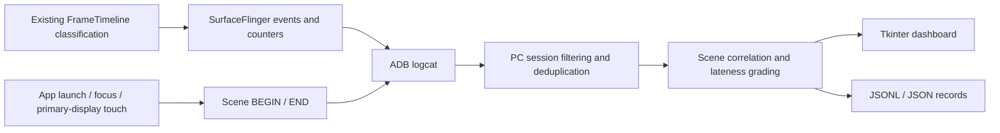

# Android16-jank · MUST Scene-Aware Jank Monitor

**Scene-aware Jank monitoring for Android 16 / LineageOS 23.2**

A system-wide FrameTimeline-based Jank monitor with scene correlation and a Python/Tkinter desktop dashboard. Android determines Deadline Jank; the PC correlates interaction scenes, grades presentation lateness, visualizes type distributions, and saves session evidence.

## Current Status — October 18, 2026

| Component | Status |
|---|---|
| Android monitor | Implemented: `must_jank` service, FrameTimeline classification collection, continuous sessions, and cumulative statistics |
| Scenes | App launch, app switching, touch dragging, and inferred fling requests; the last two use heuristics |
| PC dashboard | Python/Tkinter monitoring page and a separate full-window Jank type statistics page |
| Presentation lateness | low / medium / high / ungraded, with independently ranked types within each grade |
| Recording | JSONL events, scene intervals, device snapshots, session metadata, and severity summaries |
| Device firmware | OnePlus 11 / salami, UNOFFICIAL userdebug build dated October 15, 2026 |
| PC source | Updated October 18, 2026; distributed as a Python source package without a rebuilt EXE |
| Root-cause analysis | Type, timing, ownership, and scene evidence are available; automated scheduler, GC, lock, and GPU root-cause analysis is not implemented |

This project provides experimental system modifications and desktop tools. The firmware is an unofficial userdebug build. Existing unit-test results do not establish stability across all applications or extended device use.

## Downloads

Firmware and the PC source package are distributed through [GitHub Releases](https://github.com/Kimberley-Inti/Android16-jank/releases).

Current release: [`must-jank-2026.10.18`](https://github.com/Kimberley-Inti/Android16-jank/releases/tag/must-jank-2026.10.18).

- `lineage-23.2-20261015-UNOFFICIAL-salami.zip.part.001` and `.002`: two parts of the original ROM ZIP. Merge and verify them before sideloading.
- `boot.img`, `dtbo.img`, `init_boot.img`, `vbmeta.img`, `vendor_boot.img`, and `recovery.img`: matching images from the same build.
- `MUST_Jank_Monitor_PC_20261018.zip`: the Windows/Linux Python dashboard and launcher.
- `merge_rom.py`, `merge-rom.cmd`, `release-assets.json`, and `SHA256SUMS.txt`: merge tools, asset metadata, and checksums.

The original ROM ZIP is 2,175,603,032 bytes, exceeding GitHub's 2 GiB limit for an individual Release asset. The two parts restore the original ZIP without recompression or content changes.

See [installation and merge instructions](docs/RELEASE.md). These firmware files are for salami only; do not flash them to an x86 emulator or another device.

## Quick Start: PC Dashboard

### Windows

Install Python 3.10+ with Tcl/Tk and Android Platform-Tools. Ensure `adb.exe` is available on `PATH`. Download the PC package or clone this repository:

```powershell
git clone https://github.com/Kimberley-Inti/Android16-jank.git
cd Android16-jank
cd .\tools\must-jank-monitor
py -3 main.py
```

The Windows batch launcher in the tool directory also starts the current Python source.

### Linux

```bash
sudo apt install python3-tk adb
git clone https://github.com/Kimberley-Inti/Android16-jank.git
cd Android16-jank/tools/must-jank-monitor
python3 main.py
```

The dashboard uses Python's standard library and external ADB. The device must run a matching ROM containing the monitor service, with USB debugging enabled and the PC authorized.

### Record a Session

1. Select an authorized ADB device with state `device`, then click START.
2. Confirm that a session ID appears and use applications on the device. A single session can cover multiple applications.
3. Use the monitoring page to inspect Deadline events, layer ownership, and scenes. Use the statistics page to compare types within each lateness grade.
4. Click STOP and wait for the final records to be saved. Open the session folder to inspect the files under `sessions/`.
5. After a connection loss, you can attach to a device session that is still running. Attachment does not recover all earlier or disconnected events.

Command-line control:

```bash
adb -s <serial> shell cmd must_jank status
adb -s <serial> shell cmd must_jank start
adb -s <serial> shell cmd must_jank stats
adb -s <serial> shell cmd must_jank stop
```

## How It Works



### Counting Rules

- **Deadline Jank:** the device's `jank_type` includes AppDeadlineMissed, SurfaceFlinger CPU Deadline Missed, or SurfaceFlinger GPU Deadline Missed, represented by mask `0xE`. The PC uses the explicit device-side `deadline_jank` decision.
- **Auxiliary labels:** standalone BufferStuffing, PredictionError, and other non-deadline labels are excluded from the main Deadline count. An `AppDeadlineMissed + BufferStuffing` combination still counts as one Deadline event.
- **Counting unit:** SurfaceFrame. A single display refresh can involve multiple layer events, so an event count is not a count of perceptible stalls or episodes.
- **Headline metrics:** cumulative device-side counters across the whole session and all tracked layers. The Jank ratio is `janky_frames / valid_frames`.
- **Grade/type distributions:** events received during the local observation window. When attaching to an existing session, these counts cover a different time range from the device's full-session totals.
- **Type bitmasks:** one event can contain multiple labels. Shares of individual flags can therefore add up to more than 100%.

### Presentation-Lateness Grades

`ratio = (actual_present_ns - expected_present_ns) / (1e9 / refresh_rate)`

| Grade | Presentation lateness in refresh periods |
|---|---|
| low | `0 < ratio < 1` |
| medium | `1 <= ratio < 3` |
| high | `ratio >= 3` |
| ungraded | Deadline Jank is confirmed, but usable lateness or refresh-rate data is unavailable |

Grading applies only after the device has confirmed Deadline Jank. It preserves Android's original severity field and FrameTimeline classification. These grades describe presentation lateness and are not a validated subjective severity scale.

### Scene and Root-Cause Limitations

Touch motion does not prove that page content scrolled. Fling scenes are fixed-duration windows inferred from gesture velocity. Temporal overlap provides interaction context; it does not prove that a particular application or gesture caused a frame's Jank. Layer-based descriptions for UNKNOWN scenes remain contextual inferences.

The current implementation does not export every normal frame. Episode aggregation, automated multi-run reports, unified data-quality grading, and automated Perfetto root-cause diagnosis are not implemented.

## Repository Layout

```text
baseline/                           Historical baseline records
patches/choreographer-jank-v1.patch  Historical experimental probe
patches/must-monitor/                Current patches for three Android repositories
source/current-baseline-manifest.xml Pinned revisions before applying current patches
source/baseline-revisions.json       Patch bases and local snapshot commit references
source/modified-files/               Complete snapshots of modified Android files
source/firmware-build-info.json      Provenance of the existing device firmware
scripts/apply_must_patches.py        Base checks and patch application
scripts/merge_rom.py                 Release-part merge and verification
scripts/merge-rom.cmd                Windows merge launcher
tools/must-jank-monitor/             Current PC source, launcher, and technical documentation
docs/                               Build, release, and troubleshooting documentation
```

The current monitor does not depend on the historical Choreographer probe.

## Build and Technical Documentation

The linked implementation documents are currently provided in Chinese.

- [Detailed implementation documentation](tools/must-jank-monitor/docs/%E5%BD%93%E5%89%8D%E5%AE%9E%E7%8E%B0%E6%8A%80%E6%9C%AF%E6%96%87%E6%A1%A3.md)
- [PC usage guide](tools/must-jank-monitor/README_Windows.md)
- [Lateness grading and type frequencies](tools/must-jank-monitor/docs/%E5%88%86%E7%BA%A7%E4%B8%8E%E7%B1%BB%E5%9E%8B%E9%A2%91%E6%AC%A1%E8%AF%B4%E6%98%8E.md)
- [Source bases, patch application, and building](docs/BUILD.md)
- [Firmware assets and Release usage](docs/RELEASE.md)
- [SurfaceFlinger display-mode deadlock fix](docs/surfaceflinger-freeze-fix.md)

The historical `baseline/` records use a different frameworks/base revision. To reproduce the current implementation, use `source/current-baseline-manifest.xml` and the recorded patch bases. Do not assume that the historical Choreographer probe should be applied together with the current patches.

## Validation Records

Existing Python validation records report 22 passing checks covering session isolation, deduplication, Deadline counting, grade boundaries, BufferStuffing combinations, exported rankings, and GUI layout. The display-mode deadlock fix also has eight passing mocked native checks. The documentation describes their scope; these records do not establish full-ROM, all-application, or long-duration stability.

The ROM was not rebuilt for this publication. Firmware is dated October 15, 2026; PC source is updated through October 18, 2026.

## Team and Co-Authorship

| Member | GitHub | Project credit |
|---|---|---|
| Qinruo Liu | [Kimberley-Inti](https://github.com/Kimberley-Inti) | Co-developer |
| Siwei Han | [hsw78908-sudo](https://github.com/hsw78908-sudo) | Co-developer |
| Shengxi Qiu | [Alien147899](https://github.com/Alien147899) | Co-developer |

Project updates are credited through the commit author and `Co-authored-by` trailers. Existing history is preserved. GitHub calculates contribution graphs and statistics according to its own attribution rules.

## Copyright and Licensing

Modified Android/LineageOS files retain their original copyright and license notices. This project builds on the corresponding upstream code. No single repository-wide open-source license has been selected for newly added standalone code. Reuse and redistribution must follow the applicable file-level and upstream license terms.
