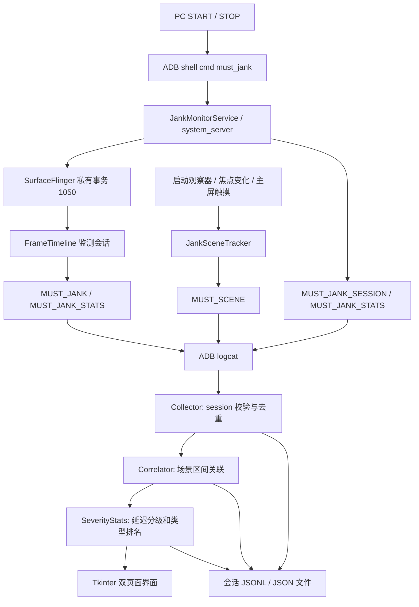

> 发布目录说明：本文依据原工作目录的 2026-10-18 Python 实现整理；本仓库已统一目录为 tools/must-jank-monitor，Windows 批处理已调整为启动 Python，不提供旧 EXE。历史工作目录中的 EXE 状态说明仅用于版本溯源。

# MUST 场景感知 Jank 监测系统：当前实现技术文档

> 整理日期：2026-10-18。依据本地 Android 源码与 `tools/must-jank-monitor` 中的 Python 界面源码整理。
> 本文描述实际实现；历史设计文档、旧 M1 分析器和旧 EXE 的能力不能直接等同于本版本能力。

## 1. 系统定位与核心结论

本系统用于在修改后的 LineageOS 系统上，持续收集系统范围的 FrameTimeline 帧分类结果，并在 PC 上关联交互场景、展示 Deadline Jank、按呈现延迟分级及统计类型分布。

完整工作链路是：

```text
Android 原有 FrameTimeline 完成帧分类
    → SurfaceFlinger 提取分类、时间戳、进程和图层信息
    → system_server 同时记录交互场景的 BEGIN/END
    → ADB/logcat 将两路结构化日志传到 PC
    → PC 校验 session、去重、关联场景、计算呈现延迟等级
    → Tkinter 界面实时显示，并保存 JSONL/JSON
```

关键区别：

- **是否算 Deadline Jank**：设备端决定，PC 使用明确的 `deadline_jank` 字段。
- **发生在什么场景**：设备提供场景区间，PC 按时间、优先级、UID 关联。
- **low / medium / high**：PC 对已确认 Deadline Jank 的呈现延迟作归一化分级。
- **为什么发生**：当前提供 FrameTimeline 类型及时间、归属、场景线索；尚未实现调度、GC、锁、GPU 等证据的自动根因分析。

一次 START 到 STOP 对应一个设备端 session，可连续切换应用和交互，无需为每个 App 重启监测。启动前和停止后不采集本监测器事件；服务随系统创建不意味着监测会话开机自动启动。

## 2. 源码范围与版本边界

### 2.1 模块划分

| 模块 | 路径（相对 Android 源码根目录） | 职责 |
|---|---|---|
| 服务入口 | `frameworks/base/services/java/com/android/server/SystemServer.java` | 启动监测服务并接入 WindowManager |
| 会话控制 | `frameworks/base/services/core/java/com/android/server/jank/JankMonitorService.java` | 发布 `must_jank`，控制 START/STOP、周期统计 |
| 场景检测 | `frameworks/base/services/core/java/com/android/server/jank/JankSceneTracker.java` | 启动、切换、触摸、惯性滑动请求场景 |
| 焦点通知 | `frameworks/base/services/core/java/com/android/server/wm/DisplayContent.java` | 焦点应用变化时通知监测器 |
| 帧分类与采集 | `frameworks/native/services/surfaceflinger/Scheduler/FrameTimeline.cpp`、`.h` | 原有分类、采集钩子、计数和事件输出 |
| SF 控制入口 | `frameworks/native/services/surfaceflinger/SurfaceFlinger.cpp` | 私有事务 1050，会话开关与统计查询 |
| 类型定义 | `frameworks/native/libs/gui/include/gui/JankInfo.h` | JankType 位掩码、Android 原生 severity 枚举 |
| 服务权限 | `system/sepolicy/private/{service.te,service_contexts,shell.te}` | 服务类型、服务名、shell 查找权限 |
| PC 入口 | `tools/must-jank-monitor/main.py` | 创建 Tkinter 主窗口 |
| PC 核心 | `tools/must-jank-monitor/monitor_core.py` | ADB、解析、收集、关联、分级、导出 |
| PC 界面 | `tools/must-jank-monitor/gui.py` | 实时事件、设备指标、等级与类型排名 |

本文的“仪表盘”指这个 Tkinter 桌面界面。当前链路不依赖 Streamlit、Pandas、Plotly，也不读取旧版 `frames.csv / episodes.csv / quality.json` 分析目录。

### 2.2 版本识别

核查时相关仓库 HEAD：

| 仓库 | HEAD |
|---|---|
| frameworks/base | `c8e9a4a21efb16c923371a740b9c1c755d17ebb2` |
| frameworks/native | `9568531f9be7ae65f260699811f32ec4e461de6e` |
| system/sepolicy | `885cc500f6078a766d1f6def5ce4c06c55841773` |

这些 HEAD 仅表示基线提交，不能表达全部本地修改。论文实验还需保留工作区补丁、实际刷入包的校验值、手机构建 fingerprint/incremental、PC 脚本版本。

目录里的 Windows EXE 为较早的打包产物；10 月 18 日的计数修正、分级、独立排名和整页布局体现在 Python 源码中，不能假定旧 EXE 已同步。原工作目录的 `启动监测器.bat` 优先启动旧 EXE；本 GitHub 发布中的批处理已改为启动最新 Python，未携带旧 EXE。

## 3. 总体架构



设备端不负责按场景生成报表；`dumpsys must_jank` 明确返回 `jank_by_scene=PC_CORRELATION_REQUIRED`。PC 不根据触摸、帧持续时间或类型名称重新判定 Deadline Jank。

## 4. 会话控制与生命周期

### 4.1 控制接口

```bash
adb -s <设备序列号> shell cmd must_jank status
adb -s <设备序列号> shell cmd must_jank start
adb -s <设备序列号> shell cmd must_jank stats
adb -s <设备序列号> shell cmd must_jank stop
adb -s <设备序列号> shell dumpsys must_jank
```

设备服务状态：`STOPPED → STARTING → RUNNING → STOPPING → STOPPED`。

START 时：

1. 检查 WindowManager、ActivityTaskManager 是否就绪。
2. 用开机经过时间的 36 进制串和 UUID 前 8 位组合生成 session ID。
3. 通知 SurfaceFlinger 开启此 session，清零帧计数与 event ID。
4. 读取主屏当前可见应用作为初始上下文。
5. 注册主屏触摸监听器和应用启动观察器。
6. 输出 START 日志，并安排每 5 秒查询 SF 累计统计。

STOP 时：

1. 取消周期查询，读取最终计数快照。
2. 通知 SF 关闭采集。
3. 注销监听器，关闭未结束场景。
4. 输出最终统计和 STOP 日志，保存 session ID 与最后快照供查询。

重复 START 在已运行时返回现有状态，PC 可选择接回。SF 关闭时内部计数会清零，因此 STOP 后主要依靠 Java 服务保存的最后快照。

### 4.2 权限

`must_jank` 的 shell/dump 接口只允许 shell、root、system UID。SF 的事务 1050 只允许 system UID，因此 PC 经 shell 调用 Java 服务，再由 system_server 控制 SF。普通第三方 App 不能直接使用该服务控制接口。

### 4.3 持续监测的含义

RUNNING 时监测不限定某个 App，可在浏览器、抖音、桌面、系统界面之间连续操作。当前采集对象为 FrameTimeline 跟踪到的各个 SurfaceFrame，包含应用和系统图层。

“系统范围”不代表每个应用的所有内部帧都可见，也不代表记录了所有正常帧，更不代表在应用无渲染、屏幕冻结或系统崩溃期间仍能产生完整事件。

## 5. FrameTimeline 主检测原理

### 5.1 判定与提取发生的位置

原有 `SurfaceFrame::classifyJankLocked()` 利用预测时间、实际完成/呈现时间、前一帧 latch 状态、刷新/渲染周期和 DisplayFrame 分类产生 JankType。

新增监测钩子位于 `flushPendingPresentFences()`：在 `DisplayFrame::onPresent()` 更新实际呈现及分类结果之后，调用 `collectMustJank()`。监测器读取既有分类，不用“超过 16.67 ms”替代 Android 原有逻辑，也不以触摸事件数量替代卡顿数量。

### 5.2 原有分类逻辑的简化解释

原有算法会比较：

```text
presentDelta  = actual.presentTime - predicted.presentTime
finishDelta   = actual.endTime     - predicted.endTime
```

- 呈现在容差以内时，通常归为按时呈现。
- 提前呈现时，可能根据与 VSync 周期的关系归为调度或预测异常。
- 延迟呈现、应用完成较晚时，可能出现 AppDeadlineMissed。
- 应用按时完成而显示链路延迟时，可以继承 DisplayFrame 的分类。
- 前一帧挤占当前帧预期呈现机会时，可能标记 BufferStuffing；算法会调整完成期限，以减少把排队等待误算成应用计算超时。
- 被新帧替换的帧可标记 Dropped。

默认阈值定义包含：完成期限容差 0 ms，呈现容差 legacy 2 ms / extended 4 ms；实际选择受 `increase_missed_frame_jank_threshold` 等特性开关影响。该简述不能替代原函数的全部分支，也不能据此认定手机当前启用了哪组开关。

### 5.3 本项目的 Deadline Jank 口径

SF 采集代码使用以下掩码：

```text
deadlineMask = AppDeadlineMissed
             | SurfaceFlingerCpuDeadlineMissed
             | SurfaceFlingerGpuDeadlineMissed
             = 0x8 | 0x2 | 0x4 = 0xE

deadline_jank = ((jank_type & 0xE) != 0)
```

因此：

| 原始值示例 | 含义 | 本项目 Deadline Jank |
|---|---|---|
| 8 | AppDeadlineMissed | 是 |
| 2 | SF CPU deadline | 是 |
| 4 | SF GPU deadline | 是 |
| 64 | 仅 BufferStuffing | 否，辅助标签 |
| 72 = 8 + 64 | App deadline 与 BufferStuffing 并存 | 是，一条 Deadline 事件 |
| 16 | 仅 PredictionError | 否，辅助标签 |
| 512 | Dropped | 否，辅助标签 |

这里的“辅助”是当前统计政策，不等于这些现象绝对没有视觉影响。例如 DisplayHAL 单独出现时也被本项目排除在 Deadline 主计数之外。

PC 的 `deadline_category()` 只接受明确的 `1/true` 或 `0/false`。缺失或非法值进入“判定缺失”，不会用“存在任意 Jank 标签”补推为 Deadline。

### 5.4 有效帧与采集筛选

`getMustJankType()` 要求预测状态为 Valid；有效预测下的 Dropped 可返回 Dropped，其他帧还要求实际呈现时间不为 0。预测缺失或过期时，本监测口径不纳入有效分类，即使原有 FrameTimeline 的其他接口可能保留分类结果。

每个 SurfaceFrame 的计数顺序：

```text
total_frames += 1
未取得可用分类 → 不计 valid，结束本帧处理
valid_frames += 1
分类恰为 None 或 Unknown → 不输出逐帧事件
其他分类 → labeled_frames += 1，并输出 MUST_JANK
其中命中 0xE → janky_frames += 1
```

注意 `Unknown` 判断是原始值相等判断；包含 Unknown 位的复合值不一定被排除。

### 5.5 统计单位

所有上述帧数以 **SurfaceFrame** 为单位。一个 DisplayFrame 可以承载多个图层的 SurfaceFrame，所以一次屏幕可见卡顿可能对应多条图层事件。它们不等于独立屏幕刷新次数、用户手势次数、连续卡顿 episode 数或主观感受到的卡顿次数。

## 6. Jank type 字典及解读

| 位值 | 标签 | 能提供的线索 |
|---|---|---|
| 0x1 | DisplayHAL | SF 以下显示链路分类 |
| 0x2 | SF CPU deadline | SF CPU/HWC 侧工作未按期完成的分类 |
| 0x4 | SF GPU deadline | SF GPU 合成侧未按期完成的分类 |
| 0x8 | App deadline | 应用侧帧准备延迟，可能涉及应用 CPU 或 GPU 等 |
| 0x10 | PredictionError | 预测与实际 VSync/呈现出现偏差 |
| 0x20 | SFScheduling | SF 调度时机相关分类 |
| 0x40 | BufferStuffing | 缓冲队列/前帧占位导致呈现后移 |
| 0x80 | Unknown | 分类原因未知 |
| 0x100 | SFStuffing | SF 前帧延长导致后续帧呈现机会后移 |
| 0x200 | Dropped | 新帧替换旧帧，旧帧丢弃 |

这些是位标志，可以同时出现。界面的“原始组合”把 72 看成一个完整类别；“独立标签”会同时给 App deadline 与 BufferStuffing 各增加一次。

因此独立标签计数之和及占比之和可以超过总帧数和 100%；这不是重复记录。原始组合的分布则可以用于互斥分类比较。

增加更多具体根因（例如 GC、主线程锁竞争、CPU 抢占）需要额外证据及分析逻辑，不能仅给现有类型换名称后宣称已检测到新根因。

## 7. 场景识别与关联

### 7.1 设备实际输出的场景

| 场景 | 来源与起止方式 | confidence | 实现边界 |
|---|---|---|---|
| APP_LAUNCH | Activity 启动观察器；启动回调开始，完成/取消回调结束 | HIGH | 当前前台同包的启动会被跳过；包含 COLD/WARM/HOT 子类型 |
| APP_SWITCH | 焦点包名从非空旧包变为不同的新包；固定 500 ms 区间 | MEDIUM | 是焦点变化窗口，不是精确转场动画时长 |
| SCROLL_TOUCH | 主屏触摸位移超过阈值的 MOVE 累计至少两次后开始；UP/CANCEL 或焦点变化结束 | MEDIUM | 触摸运动推断，不能证明内容真的滚动 |
| SCROLL_FLING | UP 时已有触摸场景，合速度大于 1200 px/s；固定 700 ms 区间 | LOW | 代表惯性滑动请求推断，不是实际惯性动画完成时刻 |

触摸阈值：`max(24 px, 2 × scaledTouchSlop)`。MOVE 位移相对 DOWN 坐标计算；源码是超阈值次数累计，不应描述成严格连续两帧超阈值。

服务开始时另输出 CONTEXT，记录初始前台包。CONTEXT 不是一段可直接统计的交互场景。

PC 字典还包含 CONFIG_CHANGE、SYSTEM_UI、IME、WINDOW_TRANSITION、GESTURE、ANIMATION、PASSIVE_UPDATE，但当前 `JankSceneTracker` 没有独立输出这些场景的检测器。支持名称显示不代表已实现检测。

### 7.2 为什么手指轻微滑动仍可能增加 Jank

触摸场景检测不产生 Deadline Jank。即便页面没有切换，按压反馈、视图重绘、输入响应或其他系统图层仍可能提交帧，设备会继续分类这些帧。

是否增加主计数，取决于收到的 `deadline_jank=1`；仅有 BufferStuffing 等辅助标签不会增加本地 Deadline 主计数。应查看事件的 owner、layer、类型和时间，不能只看页面是否切换。

### 7.3 PC 时间关联规则

Correlator 保存以 `session:scene_id` 为键的区间。对每条帧事件，选择：

```text
scene.session == frame.session
scene.begin_ns <= frame.ts_ns
未收到 END，或者 frame.ts_ns <= scene.end_ns
```

多个场景重叠时，按以下元组降序排序：

1. 场景优先级。
2. scene.owner_uid 与 frame.uid 是否相等。
3. 场景开始时间，较新者优先。

第一项成为 `primary_scene`，其余保留为 `secondary_scenes`；同时保存所有 `scene_ids` 与主场景 confidence。UID 匹配排在场景优先级之后，不是强制归属约束。

优先级：APP_LAUNCH 100、APP_SWITCH 95、CONFIG_CHANGE 90、SYSTEM_UI 85、IME 80、WINDOW_TRANSITION 75、SCROLL_FLING 70、SCROLL_TOUCH 65、GESTURE 60、ANIMATION 50、PASSIVE_UPDATE 20、UNKNOWN 0。

**这是时间上下文关联。** 高优先级场景可以覆盖同时间另一应用图层的事件；前台应用名称也不能替代帧归属。当前一次在线关联后不会因迟到的 BEGIN/END 自动重写之前输出的行，跨进程日志到达顺序会影响边界附近结果。

### 7.4 UNKNOWN 与图层上下文

没有匹配场景时，原始 `primary_scene` 保持 UNKNOWN。界面可额外根据 layer/owner 给出：输入法图层更新、任务栏更新、系统界面图层更新、桌面图层更新或应用图层更新等文字。

这些显示标签明确附带“交互未识别”“图层推断”等说明，保存在 `scene_display`，不会伪造成真实 IME/SYSTEM_UI/滑动场景。

### 7.5 应用与多屏限制

UID→包名映射来自 `cmd package list packages -U`，在采集开始/接回时读取。共享 UID 保留多个候选包；只有单个候选时 PC 才标 HIGH 归属置信度。这仍是 UID 包映射，不是对特定进程组件的独立取证。

触摸监听注册在 display 0；启动初始上下文也取 display 0。当前多屏、复杂多窗口、多指交互的场景覆盖有限，不能宣称所有屏幕交互都已精确识别。

## 8. 时间戳与字段定义

Java 场景和会话时间使用 `SystemClock.elapsedRealtimeNanos()`。FrameTimeline 默认使用 BOOTTIME 输出路径，把原有 MONOTONIC 时间通过 `BOOTTIME - MONOTONIC` 偏移转换；实际构造配置若改为不使用 BOOTTIME，需重新核查跨源关联。

时间戳是设备开机时间轴上的纳秒数，不是 Unix 时间戳。PC `start_time_wall` 是电脑墙钟时间，不应用它直接减设备 `ts_ns`。

| MUST_JANK 字段 | 意义 |
|---|---|
| session、event_id | 设备会话 ID、会话内事件序号 |
| ts_ns | 优先实际呈现时间；没有正值时用当前 BOOTTIME |
| pid、uid | SurfaceFrame 所记录的拥有者 |
| layer_id、layer | 图层 ID 与名称；部分特殊字符在设备输出时替换为下划线 |
| surface_frame_token | SurfaceFrame token，用于帧关联线索 |
| display_frame_token | 所属 DisplayFrame token |
| input_event_id | 输入关联线索；有字段不保证每帧都有可用输入事件 |
| expected_present_ns | 预测呈现时间；不可用时为 0 |
| actual_present_ns | 实际呈现时间；不可用时为 0 |
| delay_ns | 两个呈现时间均可用时的差值，否则为 0 |
| jank_type | Android 原始类型位掩码 |
| deadline_jank | 设备基于 0xE 的明确判定 |
| severity | Android 原生 severity 枚举 |
| refresh_rate | DisplayFrame 提供的刷新率，输出保留两位小数 |

`delay_ns` 表示呈现时间偏差，不是帧从开始到结束的执行耗时，也不是完整输入到显示延迟。当前逐事件日志没有完整记录实际开始/完成时间，不能仅凭这些字段重建线程工作耗时。

## 9. 呈现延迟等级 low / medium / high

### 9.1 公式与边界

PC 仅对明确 Deadline 事件执行分级：

```text
L = actual_present_ns - expected_present_ns
    （两个时间均为正时优先使用；否则尝试 delay_ns）
T = 1,000,000,000 / refresh_rate
R = L / T
```

| 等级 | 条件 | 60 Hz 近似范围 | 120 Hz 近似范围 |
|---|---|---|---|
| low | 0 < R < 1 | 0～不足 16.67 ms | 0～不足 8.33 ms |
| medium | 1 ≤ R < 3 | 16.67～不足 50 ms | 8.33～不足 25 ms |
| high | R ≥ 3 | ≥50 ms | ≥25 ms |
| ungraded | Deadline 已确认，但延迟/刷新率不可用、非有限或非正 | 无法分级 | 无法分级 |

辅助标签及判定缺失事件为 `not_applicable`，不会补成 low。正好 1 周期属于 medium，正好 3 周期属于 high。

方法标识为 `presentation_lateness_refresh_periods_v1`，派生字段为 `jank_level`、`severity_ratio`、`severity_lateness_ns`、`severity_period_ns`、`severity_method`。

### 9.2 与原生 severity 的区别

Android 原生 severity：Unknown=0、None=1、Partial=2、Full=3；它结合原有 FrameTimeline 逻辑及应用渲染周期产生。

PC 分级使用事件刷新率对应的显示周期，阈值为 1 和 3 周期。两者不是一一对应关系；PC 保留原始 `severity`，不会把它覆盖成 low/medium/high。

该等级度量“呈现晚了多少个显示周期”，不是已验证的主观流畅度量表。不同 App 目标帧率、刷新率模式、队列状态会影响分布。

### 9.3 为什么 medium 可能最多

没有规则要求 low 最多或 high 最少。分布由延迟数据决定。呈现受刷新机会约束时，晚 1～2 个周期的帧容易落入 medium；伴随 Deadline 的 BufferStuffing 也可能使呈现后移。

这只是可能解释。判断某次实验为什么 medium 多，需要检查该次 `severity_ratio` 分布、刷新率和类型组合，不能只凭数量宣称一定由 BufferStuffing 导致。

## 10. 指标、频次和类型排名

### 10.1 设备累计与本地接收必须分开

| 指标 | 实际口径 |
|---|---|
| total_frames | SF 在当前 session 中遍历的 SurfaceFrame 数 |
| valid_frames | 通过监测分类可用性检查的 SurfaceFrame 数 |
| janky_frames | 设备端命中 Deadline 掩码的 SurfaceFrame 数 |
| labeled_frames | 排除恰为 None/Unknown 后的标签事件数 |
| 顶部 Jank 百分比 | janky_frames / valid_frames；分母为 0 时显示 — |
| received_label_events | PC 接受的、属于绑定 session 且去重后的所有标签事件数 |
| total_jank | PC 本地接收的明确 Deadline 事件数 |
| auxiliary_label_events | PC 本地接收的明确非 Deadline 标签事件数 |
| unknown_deadline_events | PC 本地接收但 Deadline 字段不可用的事件数 |

正常情况下本地接收可能与设备计数相符，但接回、日志丢失、断连、停止边界均可能造成差异。顶部使用设备快照，约 5 秒刷新一次；SF 与 Java 都可输出统计快照，重复快照不能相加。

### 10.2 频次

```text
某等级频次（次/分钟） = 本地该等级 Deadline 事件数 × 60 / 本地观察秒数
某标签级内占比       = 本等级含该标签的事件数 / 本等级 Deadline 事件数
某标签频次（次/分钟） = 本等级含该标签的事件数 × 60 / 本地观察秒数
```

观察时间来自 Collector 的 PC 单调时钟，从创建本地采集器开始，包含准备和空闲时间，到收到 STOP 或关闭采集器时冻结。它不是按场景有效时长，不是 App 活跃渲染时长，也不是设备完整 session 的历史时长。

接回时设备顶部可能已经有大量累计帧，但等级统计仅含接回后收到的事件。不能把它们拼成同一完整实验的分级比例。

### 10.3 每等级独立排名

low、medium、high 分别维护独立榜单，按数量降序，同数量按名称排序。原始组合与拆分标签分别排名；ungraded 独立展示。

例如一条 high 的 72：high 事件数增加 1，high 组合“72”增加 1，high 的 App deadline 与 BufferStuffing 标签各增加 1。界面将后者说明为“BufferStuffing（伴随 Deadline）”。

## 11. PC 采集与一致性保护

1. 新建唯一时间目录，创建原始和结构化文件。
2. 查询设备型号、构建属性和 UID 包映射。
3. 先启动 `adb logcat -v brief -T 1`，仅订阅四个 MUST 标签，再发送设备 START。
4. 在未确定 session 时暂存事件，最多 4096 条，超出丢弃最旧项并记录计数。
5. 从 START/status 命令返回值绑定 session，只回放该 session 的事件。
6. 使用 `(session, event_id)` 对 MUST_JANK 去重；没有 ID 时保留并记录质量计数。
7. 写入原始事件，关联场景，计算分级，写入派生事件，并通过线程队列更新界面。

`-T 1` 不代表读取完整历史；接回只尝试从当前日志尾部继续。logcat 是有容量限制的日志传输，不是可靠消息队列。原始文件保存已读取日志，结构化文件只接收通过 session 等检查的记录。

STOP 命令成功后 GUI 等待约 500 ms 再关闭 reader，旨在接收尾部日志，但不是严格的日志排空协议。设备侧最终快照查询与关闭采集也是两个操作；极小停止窗口内可能出现尾部计数差异。

## 12. 仪表盘页面与交互

### 12.1 Deadline Jank / 监测与事件

包括设备选择、刷新、START/STOP、session、上下文、计时、有效/总帧数、设备累计 Deadline 数、累计比例和实时事件表。

默认范围为 Deadline Jank，可切换辅助标签、判定缺失及全部标签；等级过滤作用于事件表。设备顶部统计不会随列表过滤重新计算。

事件显示时间、类别、等级、归属、场景、原始类型和呈现偏差。界面最多保留最近 600 条用于显示/重新过滤；累计统计及已写入文件不受这个上限影响。清空列表不清空会话数据或累计指标。

### 12.2 Jank type 统计与比较

该页占用整个窗口内容区，监测页控制区不会重复占据上半屏。包含等级数量条、low/medium/high 各自排名、拆分标签、原始组合、未分级及原始标签分布。

等级统计始终只针对 Deadline；原始标签页可以选择辅助等范围。切换页面不会停止监测、清空计数或创建新会话。

当前图形主要是条形数量展示和排名表，不是旧版 Frame Timeline、Episode Timeline、窗口 Jank Rate 或多 run 报表。当前没有完整正常帧事件流，因此也不能直接提供全量逐帧正常/异常时间线。

### 12.3 刷新与退出

后台线程读取日志，主线程约每 100 ms 消费队列；计时更新约 250 ms，等级表约 1 秒刷新，设备列表约 4 秒刷新。高日志量下的 UI 队列、逐行写文件和 logcat 开销尚未形成长期性能基准。

运行中关闭窗口会要求先 STOP 并保存，拒绝时保留窗口。ADB 断连会提示数据可能不完整；手机端 session 可能仍运行，重连后可接回，但不会补齐断连期间历史事件。

## 13. 会话数据文件

目录：`tools/must-jank-monitor/sessions/<时间>_<设备>/`，接回目录带 `_attached_`。

| 文件 | 内容 | 主要用途 |
|---|---|---|
| raw.log | logcat reader 读到的原始文本 | 排查解析和传输问题 |
| jank.jsonl | 接受后的 MUST_JANK 原始字段 | 复核设备判定；包含辅助事件 |
| scenes.jsonl | 场景 CONTEXT/BEGIN/END | 场景证据与区间复核 |
| correlated_jank.jsonl | 原始字段 + 场景、归属、分级 | 实验统计主事件表 |
| stats.jsonl | 设备累计统计快照 | 对照设备总量，不能逐行求和 |
| session.json | 元数据、状态、设备计数、本地计数、异常计数 | 说明实验范围和完整性 |
| severity_summary.json | 各等级数量、频次、类型排名、方法与阈值 | 类型比较与报告 |

JSONL 一行一个 JSON。日志解析得到的多数原始数值仍为字符串；派生 ratio、时间周期等可以是数值或 null，读取时需要按字段转型。

派生行示意（非真实实验记录）：

```json
{
  "session": "example_session",
  "event_id": "42",
  "deadline_jank": "1",
  "jank_type": "72",
  "refresh_rate": "120.00",
  "expected_present_ns": "10000000000",
  "actual_present_ns": "10016666667",
  "primary_scene": "SCROLL_TOUCH",
  "secondary_scenes": [],
  "scene_confidence": "MEDIUM",
  "owner_packages": ["example.app"],
  "jank_level": "medium",
  "severity_ratio": 2.00000004,
  "severity_method": "presentation_lateness_refresh_periods_v1"
}
```

汇总文件在初始化、会话事件、统计快照和关闭等时机更新，并非每条帧事件后立即重写。当前 JSON 汇总为直接写入，进程异常中断时存在最后一次写入不完整的风险；JSONL 可保留此前已落盘行。

## 14. 数据质量与解释边界

当前没有旧 M1 那套统一的 `VALID/PARTIAL/INVALID/NO_DATA quality.json` 校验体系。设备状态与 PC 文件中的 `state` 也不是严格实验有效性认证。

| 质量线索 | 说明 |
|---|---|
| ignored_foreign_events | 拒绝了其他 session 的日志，可能来自日志尾部或其他会话 |
| duplicate_events | 重复事件 ID 被排除 |
| events_without_event_id | 无法用 ID 进行可靠去重的事件数量 |
| pending_events_dropped | 绑定 session 前缓存溢出 |
| unknown_deadline_events | 无法确定主计数类别的本地事件 |
| valid_frames / total_frames | 监测分类可用覆盖率，不是实验完整性全部条件 |
| 本地 Deadline 与设备 janky_frames 的差值 | 可能反映接回、丢日志、边界等，需结合上下文判断 |
| state=PARTIAL | reader 关闭时未见正常 STOP 等情况下保存的本地状态 |
| sf_stats_unavailable | 服务查询 SF 统计失败的原因提示 |

STOPPED 不能证明日志零丢失；Unknown 场景低也不能证明归因准确。现有代码没有把每一次 SF 查询错误完整升级为 GUI 统一质量结论，也没有完整的跨会话根因证据可用性报告。

## 15. 根因证据分析：已有线索与尚缺能力

### 15.1 当前可以回答

- 哪个时间点出现了设备确认的 Deadline 事件？
- 对应哪个 pid/uid/layer，以及哪些候选包名？
- 与哪些已识别交互区间重叠？
- Android 给出的 App/SF CPU/SF GPU 等分类是什么？是否伴随 BufferStuffing？
- 呈现晚了多少毫秒/显示周期，属于哪个等级？
- 各等级最常见的类型与组合是什么？

### 15.2 当前不能单独证明

| 待验证原因 | 需要补充的证据示例 | 当前自动采集情况 |
|---|---|---|
| CPU 调度等待/抢占 | sched_switch、sched_wakeup、线程状态 | 未实现 |
| 主线程代码执行过长 | 线程切片、应用 trace、必要时采样栈 | 未实现 |
| GC 停顿 | ART/GC trace、停顿时间与主线程关联 | 未实现 |
| 锁/Binder 等待 | blocked 状态、Binder transaction、栈 | 未实现 |
| GPU 工作过长 | GPU/fence/渲染任务证据 | 未实现独立根因分析 |
| 降频/温控/资源压力 | CPU/GPU 频率、温控、内存/IO 证据 | 未实现 |
| BufferStuffing 的上游起因 | 前序帧、queue/latch/dequeue 时间与调度 | 仅有分类标签，证据不完整 |

这些为后续建设方向，不应写成现有根因引擎。当前没有一键 Perfetto 触发、诊断时间窗索引、根因置信度评分或自动报告闭环。

### 15.3 当前可执行的人工分析流程

1. 用 `correlated_jank.jsonl` 选 high/medium 事件，记录 session、ts_ns、owner、layer 和两种 token。
2. 确认事件为 Deadline，并区分组合与拆分标签。
3. 用 `scenes.jsonl` 核对场景证据和时间边界，不能只看界面推断文字。
4. 对可复现场景另行同步采集 Perfetto；先核对 trace 时钟域，再定位对应时间窗。
5. 沿应用线程→RenderThread/GPU→BufferQueue→SF→显示链路寻找证据。
6. 将结论记录为“分类线索”“相关证据”或“已验证原因”，保留证据强度区别。

仅凭 `App deadline + BufferStuffing` 可以说“该帧同时有应用期限错过和缓冲挤占标签”，不能直接说“必然由 GC 或某段代码导致”。

## 16. 使用方法

### 16.1 Linux 启动当前 Python 界面

手机需刷入带 `must_jank` 的匹配镜像，启用 USB 调试并授权电脑。

```bash
cd "/path/to/Android16-jank/tools/must-jank-monitor"
export PATH="/path/to/lineage/out/host/linux-x86/bin:$PATH"
/usr/bin/python3 main.py
```

缺 Tkinter 时安装系统包 `python3-tk`。普通采集不需要重新编译 Android，不需要运行 `source build/envsetup.sh` 或 lunch。

### 16.2 Windows 使用当前源码

安装带 Tcl/Tk 的 Python 3.10 或更新版本，并使 Platform-Tools 的 `adb.exe` 在 PATH 中可用。在该程序文件夹执行：

```powershell
py -3 .\main.py
```

本版使用 Python 标准库。要使用本次 Python 新功能，应运行源码，或以后重新打包 EXE；原工作目录的批处理指向较早 EXE；本发布批处理已指向 Python。

### 16.3 一次实验

1. 选择已授权、状态为 device 的设备，START。
2. 确认显示实时监测和 session ID。
3. 在手机连续操作不同 App，观察事件 owner、scene 和类型。
4. 在统计页比较各等级类型，必要时切到辅助标签检查 BufferStuffing。
5. STOP，等待最终统计保存，再打开会话文件夹。
6. 保存完整会话目录、手机构建信息、PC 源码版本和实验条件。

复现实验建议固定刷新率模式、操作流程、App 版本、温度/电量区间和观察时长。多次重复实验使用独立 session；当前没有专门的 run 元数据及多 run 比较页面。

## 17. 数据核对办法

以下为人工/离线复核规则，不是宣称本次已重新运行测试：

1. `jank.jsonl` 中明确 `deadline_jank=1/true` 的接受事件数，应与 `session.json.total_jank` 一致（正常结束且汇总已保存时）。
2. 明确非 Deadline、判定缺失和 Deadline 三类之和应等于 `received_label_events`。
3. 从 Deadline 行按公式重新计算等级，各等级之和包含 ungraded，应等于本地 Deadline 数。
4. `severity_summary.json` 每级 count 应匹配派生事件文件；各级排名按 count 降序，平局按键名排序。
5. 独立标签要按位计算，不能把组合 72 当成第 72 种单独标志，也不能要求拆分占比总和为 100%。
6. 将最后设备快照与 GUI 顶部比较；不要对 `stats.jsonl` 的累计值求和。
7. 若本地与设备不等，先查 attached、session、异常计数、断连和 STOP 尾部，再判断是否为算法错误。

已存在的 `test_monitor_semantics.py` 覆盖 session 绑定、外来会话/重复排除、Deadline 字段口径、分级边界、混合 BufferStuffing、时间戳优先、导出排名、GUI 过滤和整页布局等。

已有验证日志 `/tmp/must-jank-layout-20261018/tests.log` 记录 22 项通过。该记录证明对应 Python 行为用例通过，不代表整套 ROM 的长期性能、所有 App 场景或实际闪存产物已完成全量验证；本次整理文档没有重新编译或运行这些测试。

## 18. 当前能力清单与后续优先级

| 能力 | 当前状态 |
|---|---|
| 系统范围持续 START/STOP、多 App 连续采集 | 已实现，限 RUNNING 会话 |
| FrameTimeline Deadline 主口径、辅助标签分离 | 已实现 |
| 启动/切换/触摸/惯性请求场景 | 已实现，含启发式与覆盖限制 |
| 精确识别所有 UI 动画、输入法、配置变化 | 未实现独立检测器 |
| low/medium/high 与独立类型排名 | 已实现于当前 Python |
| 设备累计与本地接收分离、session 校验、去重 | 已实现 |
| 结构化落盘及当前会话界面 | 已实现 |
| 全量正常帧时间线、episode 聚合与频率 | 未实现于本链路 |
| 多 run 对比、按场景有效时间归一化 | 未实现 |
| 调度/GC/锁/GPU 根因证据自动分析 | 未实现 |
| 完整质量判级、丢日志恢复与离线重关联 | 未实现 |
| 最新 Python 功能同步为 Windows EXE | 本发布使用 Python 启动包，EXE 尚需重新打包 |

建议后续顺序：先固定设备镜像与 PC 源码版本，补全质量和停止边界校验；再做离线场景重关联与场景有效时长；随后接入有时钟对齐的 Perfetto 证据，最后扩展 episode 和多实验可视化。

## 19. 阅读源码的建议顺序

1. `JankMonitorService.start()/stop()`：理解会话边界。
2. `SurfaceFrame::classifyJankLocked()`：理解 Android 原有标签产生条件。
3. `getMustJankType()`、`collectMustJank()`：理解本项目采集筛选和主计数。
4. `JankSceneTracker`：理解场景证据与启发式时间窗。
5. `monitor_core.py` 的 `Collector`、`Correlator`：理解传输、过滤、关联和落盘。
6. `classify_severity()`、`SeverityStats`：理解等级和类型频次。
7. `gui.py`：理解设备指标、本地统计和页面显示范围。

同目录相关说明：[触摸与计数核查](触摸与Jank计数核查.md)、[分级与类型频次说明](分级与类型频次说明.md)、[Windows 使用说明](../README_Windows.md)。
